# 基于Vue.js高校学生选课系统

> 🎓 **计算机毕业设计 · 基于Vue.js高校学生选课系统**
>
> 本仓库只放**项目介绍 + 运行截图**（截图是站点带水印的原图，存在仓库 `images/` 里）。
>
> 👉 **完整可运行源码 / 数据库脚本 / 部署文档：[点我获取](https://geekcode.top/archives/%E5%9F%BA%E4%BA%8EVue.js%E9%AB%98%E6%A0%A1%E5%AD%A6%E7%94%9F%E9%80%89%E8%AF%BE%E7%B3%BB%E7%BB%9F?utm_source=github)**
>
> 💬 咨询微信：**ir9372**　|　🌐 更多项目：[极客代码 geekcode.top](https://geekcode.top/?utm_source=github)
>
> 📌 项目详情页：<https://geekcode.top/archives/%E5%9F%BA%E4%BA%8EVue.js%E9%AB%98%E6%A0%A1%E5%AD%A6%E7%94%9F%E9%80%89%E8%AF%BE%E7%B3%BB%E7%BB%9F?utm_source=github>

<table><td width="230" align="center"> <b>扫码加微信 ir9372</b></td><td valign="middle">📦 源码 = 项目介绍 + 全部运行截图 + 数据库 + 部署文档 👉 点上方任意截图，直接跳到 <b>极客代码 geekcode.top</b> 详情页</td></table>

---

<h1>基于Vue.js高校学生选课系统</h1>
<h2>项目概述</h2>

本项目旨在构建一个基于 Vue.js 与 Spring Boot 的高校学生选课系统，解决传统高校教务管理中选课流程繁琐、信息分散及权限管理混乱的问题。系统采用前后端分离架构，前台面向学生、教师及管理员提供课程浏览、公告查看及个人信息管理功能；后台提供全面的数据维护与管理能力。核心功能涵盖学生选课、退课、成绩录入、课程评论及基础数据（班级、教师、课程类型）管理。适用人群包括高校教务处管理人员、任课教师及在校学生。技术架构上，后端依托 Spring Boot 框架实现业务逻辑，利用 MyBatis-Plus 简化持久层开发，并集成 Shiro 进行安全认证与授权，确保系统数据的完整性与访问的安全性。

<h2>技术架构</h2>
<h3>前端架构</h3>

前端采用 Vue.js 框架构建单页应用（SPA），通过 Axios 与后端接口进行异步数据交互。界面设计遵循响应式原则，适配不同屏幕尺寸，提升用户体验。前台导航包含首页、课程信息及公告信息，后台路由覆盖所有业务模块的管理页面。

<h3>后端架构</h3>

后端基于 Spring Boot 快速搭建，遵循 MVC 设计模式：

<ul>
<li><strong>Controller 层</strong>：由 <code>BanjixinxiController</code>、<code>JiaoshiController</code>、<code>KechengxinxiController</code> 等控制器组成，负责接收 HTTP 请求并调用 Service 层处理业务逻辑。</li>
<li><strong>Service 层</strong>：封装核心业务规则，如选课冲突检测、成绩计算逻辑等。</li>
<li><strong>DAO/Mapper 层</strong>：使用 MyBatis-Plus 作为 ORM 框架，自动生成基础 CRUD 操作，减少样板代码，提高开发效率。</li>
<li><strong>安全机制</strong>：集成 Apache Shiro (<code>shiro-spring</code>)，实现用户身份认证（Authentication）和细粒度的访问控制（Authorization），保护敏感接口不被未授权访问。</li>
</ul>
<h3>数据库设计要点</h3>

数据库选用 MySQL，主要实体表包括：

<ul>
<li><strong>用户相关</strong>：<code>users</code> (通用账户), <code>xuesheng</code> (学生详情), <code>jiaoshi</code> (教师详情)。</li>
<li><strong>课程相关</strong>：<code>kechengxinxi</code> (课程基本信息), <code>banjixinxi</code> (班级信息), <code>kechengleixing</code> (课程分类)。</li>
<li><strong>业务记录</strong>：<code>xueshengxuanke</code> (选课记录), <code>xueshengtuike</code> (退课记录), <code>xueshengchengji</code> (成绩表), <code>kechengpinglun</code> (课程评价)。</li>
<li><strong>系统配置</strong>：<code>config</code> (参数配置), <code>news</code> (公告新闻), <code>systemintro</code> (系统简介)。</li>
</ul>
<h2>功能模块</h2>
<h3>前台用户端</h3>

前台界面简洁直观，主要服务于普通用户的信息查询与互动需求：

<ol>
<li><strong>首页展示</strong>：展示系统最新动态、热门课程推荐及重要公告摘要。</li>
<li><strong>课程信息浏览</strong>：列表展示所有开设课程，支持按课程类型筛选，显示课程名称、授课教师、上课时间等详细信息。</li>
<li><strong>公告信息查看</strong>：集中展示学校发布的教务通知、选课指南等官方公告。</li>
<li><strong>个人中心</strong>：</li>
</ol>
<ul>
<li><strong>我的选课</strong>：查看已选课程列表及状态。</li>
<li><strong>我的退课</strong>：查看历史退课记录。</li>
<li><strong>我的成绩</strong>：查询各科目的考试成绩。</li>
<li><strong>课程评论</strong>：对已修读或正在修读的课程发表评价。</li>
<li><strong>个人信息维护</strong>：修改个人基本资料。</li>
</ul>
<h3>后台管理端</h3>

后台为管理员提供全量的数据管理与系统配置功能：

<ol>
<li><strong>登录与安全</strong>：管理员账号密码登录，Shiro 鉴权拦截非法访问。</li>
<li><strong>学生管理 (<code>/xuesheng</code>)</strong>：增删改查学生档案，重置密码，查看学生选课统计。</li>
<li><strong>教师管理 (<code>/jiaoshi</code>)</strong>：维护教师基本信息，分配所授课程。</li>
<li><strong>班级管理 (<code>/banjixinxi</code>)</strong>：创建和维护班级信息，关联所属院系或专业方向。</li>
<li><strong>课程管理</strong>：</li>
</ol>
<ul>
<li><strong>课程信息 (<code>/kechengxinxi</code>)</strong>：发布新课程，编辑课程详情，设置学分与容量。</li>
<li><strong>课程类型 (<code>/kechengleixing</code>)</strong>：定义课程分类标签（如必修、选修、通识等）。</li>
</ul>
<ol start="6">
<li><strong>选课业务管理</strong>：</li>
</ol>
<ul>
<li><strong>学生选课 (<code>/xueshengxuanke</code>)</strong>：审核选课申请，强制退课，导出选课名单。</li>
<li><strong>学生退课 (<code>/xueshengtuike</code>)</strong>：处理退课申请，记录退课原因。</li>
</ul>
<ol start="7">
<li><strong>成绩管理 (<code>/xueshengchengji</code>)</strong>：录入、修改学生成绩，支持批量导入导出。</li>
<li><strong>内容管理</strong>：</li>
</ol>
<ul>
<li><strong>公告信息 (<code>/news</code>)</strong>：发布和管理校园通知公告。</li>
<li><strong>课程评论 (<code>/kechengpinglun</code>)</strong>：审核用户评论，删除违规内容。</li>
<li><strong>关于我们 (<code>/systemintro</code>)</strong>：编辑系统介绍文案。</li>
</ul>
<ol start="9">
<li><strong>系统配置 (<code>/config</code>)</strong>：修改轮播图、网站标题、版权信息等全局参数。</li>
</ol>
<h2>用户角色与权限</h2>

根据系统设计及路由结构，主要划分为以下角色：

<table>
<thead>
<tr>
<th align="left">角色</th>
<th align="left">描述</th>
<th align="left">权限范围</th>
</tr>
</thead>
<tbody><tr>
<td align="left"><strong>超级管理员</strong></td>
<td align="left">系统最高权限持有者</td>
<td align="left">拥有后台所有路由的访问权限，包括 <code>/xuesheng</code>, <code>/jiaoshi</code>, <code>/kechengxinxi</code>, <code>/config</code> 等全部模块的增删改查及配置权。</td>
</tr>
<tr>
<td align="left"><strong>教师</strong></td>
<td align="left">课程负责人</td>
<td align="left"><em>(注：根据现有路由推断，若存在独立教师入口)</em> 可能仅能查看自己教授课程的学生名单、录入成绩及管理该课程的评论。若无独立教师后台，则通过“个人中心”或特定受限视图操作。<em>鉴于提供的后台路由均为通用管理路径，且未明确区分教师专属后台，此处假设教师主要通过前台或受限视图参与教学环节，或在同一后台系统中通过数据隔离权限进行操作。</em></td>
</tr>
<tr>
<td align="left"><strong>学生</strong></td>
<td align="left">课程学习者</td>
<td align="left">仅可访问前台页面。权限包括：浏览课程、查看公告、进行选课/退课操作、查看个人成绩、发表课程评论以及维护个人资料。无后台管理权限。</td>
</tr>
</tbody></table>

<em>说明：由于提供的后台路由列表较为统一，具体是否有多租户隔离或角色细分需结合源码中的 Shiro Realm 配置确定。上述权限基于典型高校管理系统逻辑推导。</em>

<h2>项目特色与创新点</h2>
<ol>
<li><strong>闭环的业务流程</strong>：实现了从“课程发布 -&gt; 学生选课 -&gt; 学习过程 -&gt; 成绩评定 -&gt; 课程评价”的全生命周期管理，数据流转清晰，符合实际教务场景。</li>
<li><strong>灵活的内容管理</strong>：不仅管理结构化数据（如成绩、选课），还集成了非结构化内容管理（如公告、评论、系统简介），使系统不仅是工具，也是信息发布平台。</li>
<li><strong>安全性保障</strong>：引入 Apache Shiro 框架，提供了成熟的会话管理和权限控制机制，有效防止越权访问和数据泄露，保障了学生隐私和教务数据的安全。</li>
<li><strong>高效开发体验</strong>：后端采用 MyBatis-Plus，大幅减少了 SQL 编写工作量；前端采用 Vue.js，组件化开发使得界面维护和扩展更加便捷，提升了系统的可维护性。</li>
</ol>
<h2>部署环境</h2>

运行本项目需要以下软硬件环境支持：

<ul>
<li><strong>操作系统</strong>：Windows 10/11, Linux (CentOS 7+, Ubuntu 18.04+), macOS。</li>
<li><strong>Java 环境</strong>：JDK 1.8 或更高版本。</li>
<li><strong>数据库</strong>：MySQL 5.7 或 8.0 及以上版本。</li>
<li><strong>前端环境</strong>：Node.js (建议 v14.x - v16.x)，npm 或 yarn 包管理器。</li>
<li><strong>Web 服务器</strong>：Nginx (用于反向代理静态资源) 或内置 Tomcat (Spring Boot 默认)。</li>
<li><strong>开发工具</strong>：IntelliJ IDEA (后端开发), VS Code (前端开发)。</li>
<li><strong>其他依赖</strong>：Maven (项目构建工具)。</li>
</ul>
<h2>五、技术特性</h2>
<ul>
<li>前后端集成部署，前端资源打包至后端 static 目录</li>
<li>使用 MyBatis-Plus 简化数据访问层开发</li>
<li>集成 Shiro 权限框架实现角色权限控制</li>
</ul>
<h2>六、功能模块截图</h2>
<h3>前台用户端</h3>
<h4>前台-班级信息列表</h4>

<h4>前台-教师列表</h4>

<a href="https://geekcode.top/archives/%E5%9F%BA%E4%BA%8EVue.js%E9%AB%98%E6%A0%A1%E5%AD%A6%E7%94%9F%E9%80%89%E8%AF%BE%E7%B3%BB%E7%BB%9F?utm_source=github" title="查看完整源码">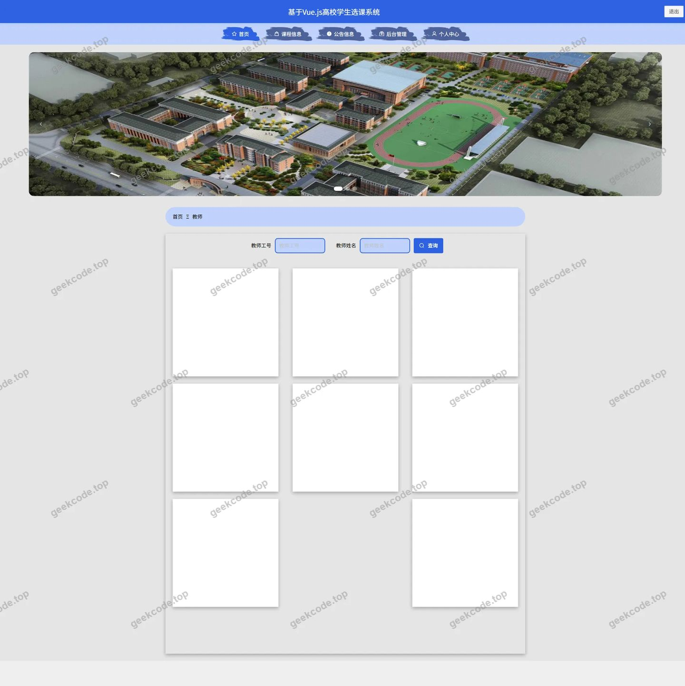</a>

<h4>前台-课程类型列表</h4>

<a href="https://geekcode.top/archives/%E5%9F%BA%E4%BA%8EVue.js%E9%AB%98%E6%A0%A1%E5%AD%A6%E7%94%9F%E9%80%89%E8%AF%BE%E7%B3%BB%E7%BB%9F?utm_source=github" title="查看完整源码">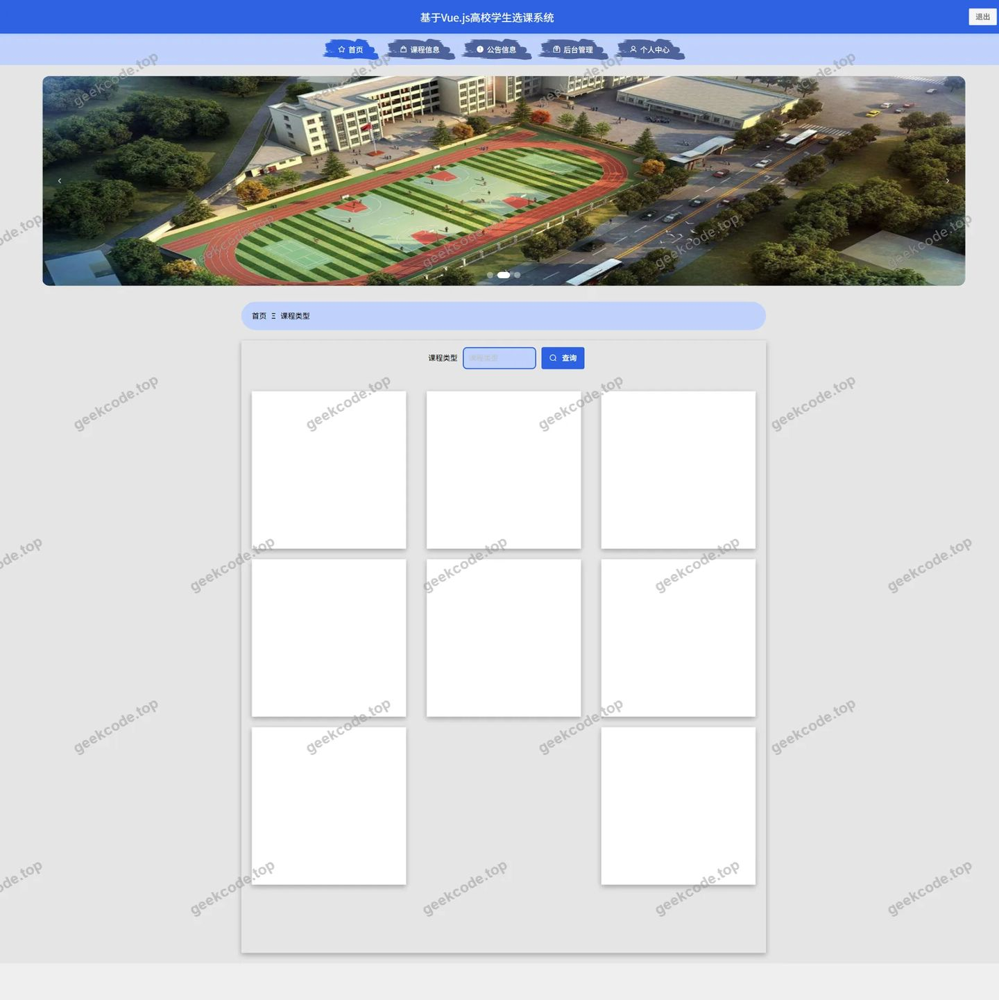</a>

<h4>前台-课程评论列表</h4>

<h4>前台-课程信息列表</h4>

<a href="https://geekcode.top/archives/%E5%9F%BA%E4%BA%8EVue.js%E9%AB%98%E6%A0%A1%E5%AD%A6%E7%94%9F%E9%80%89%E8%AF%BE%E7%B3%BB%E7%BB%9F?utm_source=github" title="查看完整源码">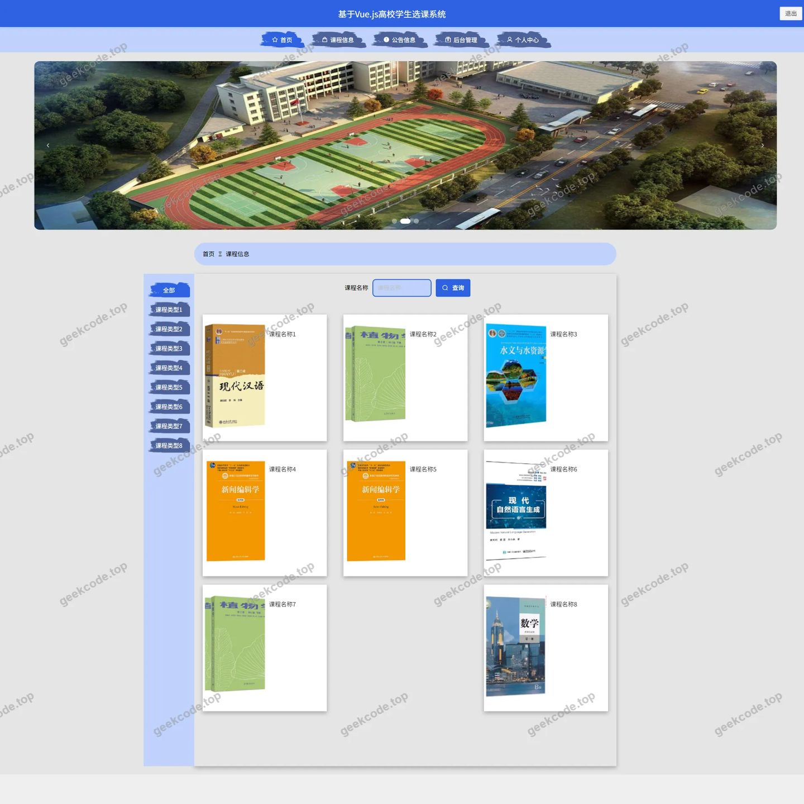</a>

<h4>前台-学生成绩列表</h4>

<a href="https://geekcode.top/archives/%E5%9F%BA%E4%BA%8EVue.js%E9%AB%98%E6%A0%A1%E5%AD%A6%E7%94%9F%E9%80%89%E8%AF%BE%E7%B3%BB%E7%BB%9F?utm_source=github" title="查看完整源码">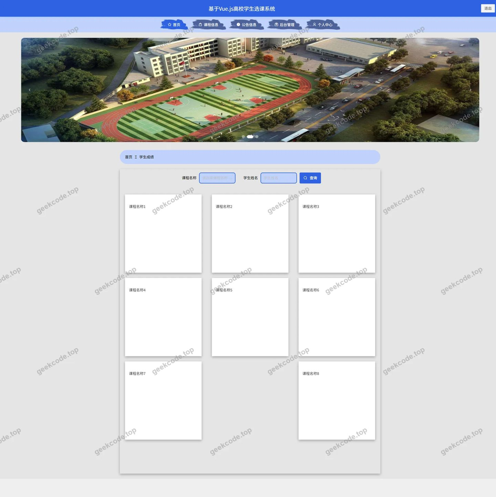</a>

<h4>前台-学生退课列表</h4>

<a href="https://geekcode.top/archives/%E5%9F%BA%E4%BA%8EVue.js%E9%AB%98%E6%A0%A1%E5%AD%A6%E7%94%9F%E9%80%89%E8%AF%BE%E7%B3%BB%E7%BB%9F?utm_source=github" title="查看完整源码">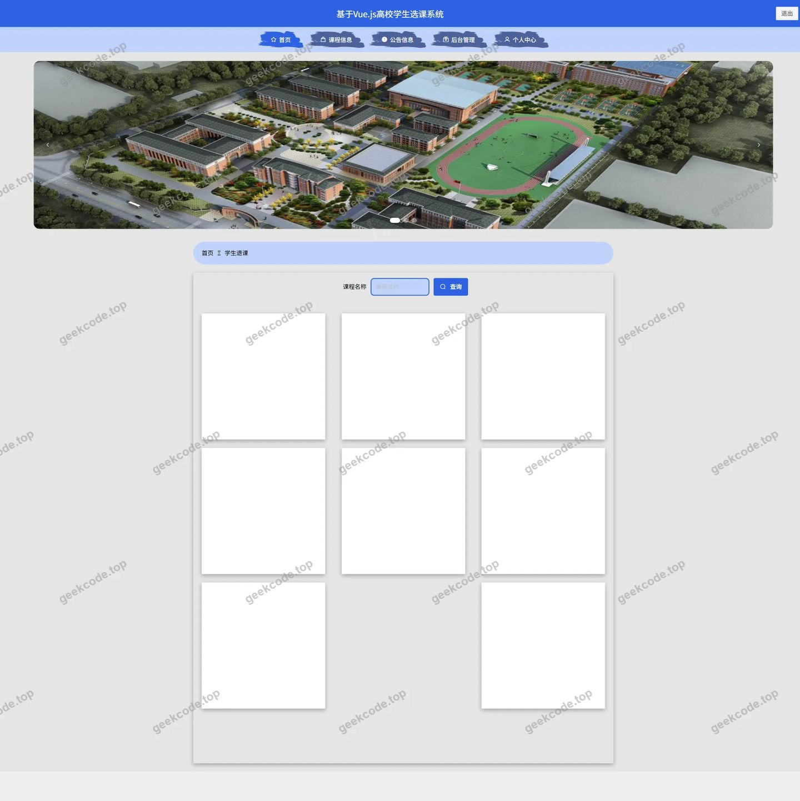</a>

<h4>前台-学生选课列表</h4>

<h4>前台-个人中心</h4>

<a href="https://geekcode.top/archives/%E5%9F%BA%E4%BA%8EVue.js%E9%AB%98%E6%A0%A1%E5%AD%A6%E7%94%9F%E9%80%89%E8%AF%BE%E7%B3%BB%E7%BB%9F?utm_source=github" title="查看完整源码">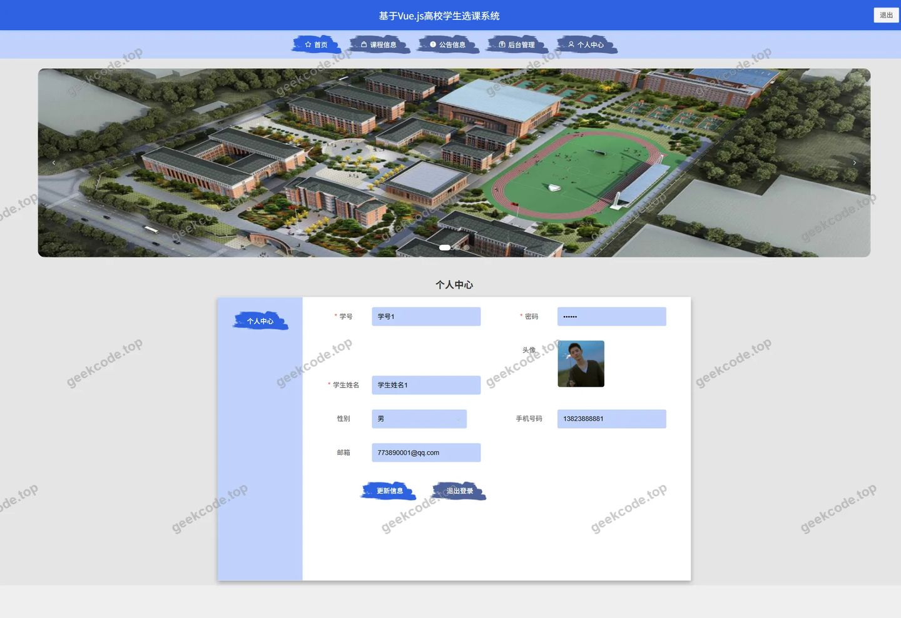</a>

<h4>前台-公告列表</h4>

<a href="https://geekcode.top/archives/%E5%9F%BA%E4%BA%8EVue.js%E9%AB%98%E6%A0%A1%E5%AD%A6%E7%94%9F%E9%80%89%E8%AF%BE%E7%B3%BB%E7%BB%9F?utm_source=github" title="查看完整源码">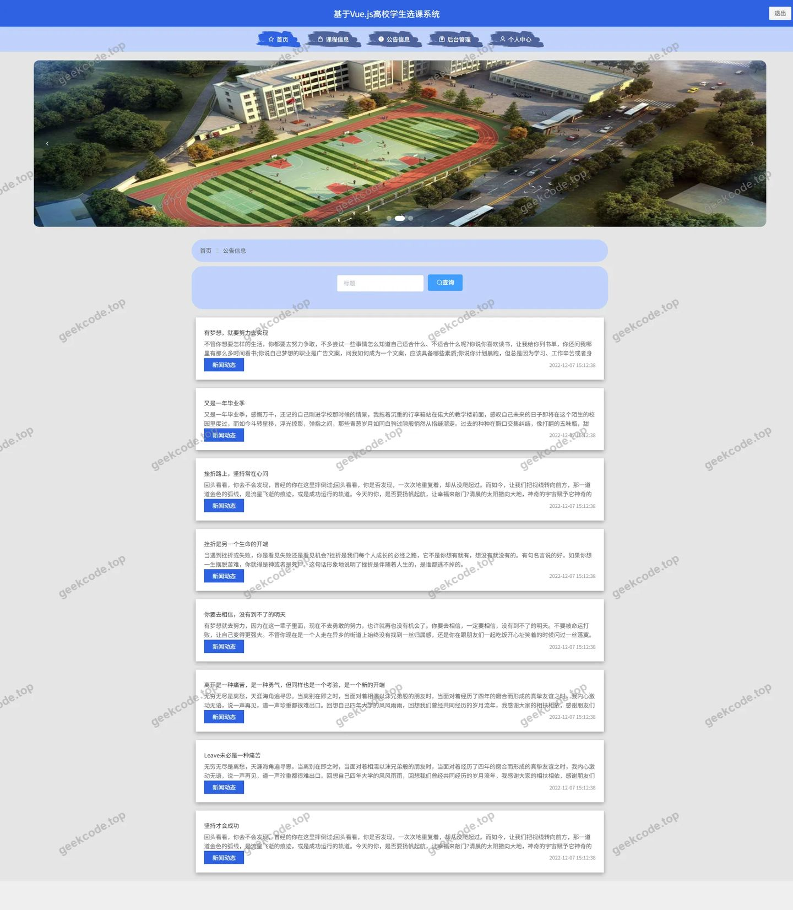</a>

<h3>后台管理端</h3>
<h4>后台-登录页</h4>

<h4>后台-公告信息</h4>

<a href="https://geekcode.top/archives/%E5%9F%BA%E4%BA%8EVue.js%E9%AB%98%E6%A0%A1%E5%AD%A6%E7%94%9F%E9%80%89%E8%AF%BE%E7%B3%BB%E7%BB%9F?utm_source=github" title="查看完整源码">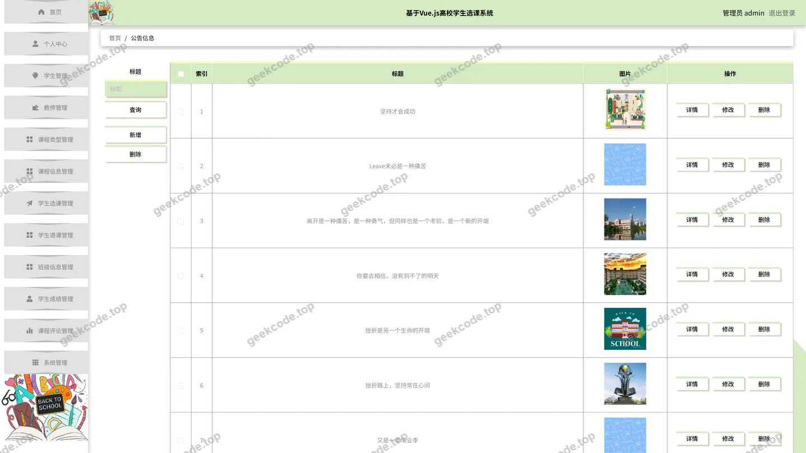</a>

<h4>后台-关于我们</h4>

<a href="https://geekcode.top/archives/%E5%9F%BA%E4%BA%8EVue.js%E9%AB%98%E6%A0%A1%E5%AD%A6%E7%94%9F%E9%80%89%E8%AF%BE%E7%B3%BB%E7%BB%9F?utm_source=github" title="查看完整源码">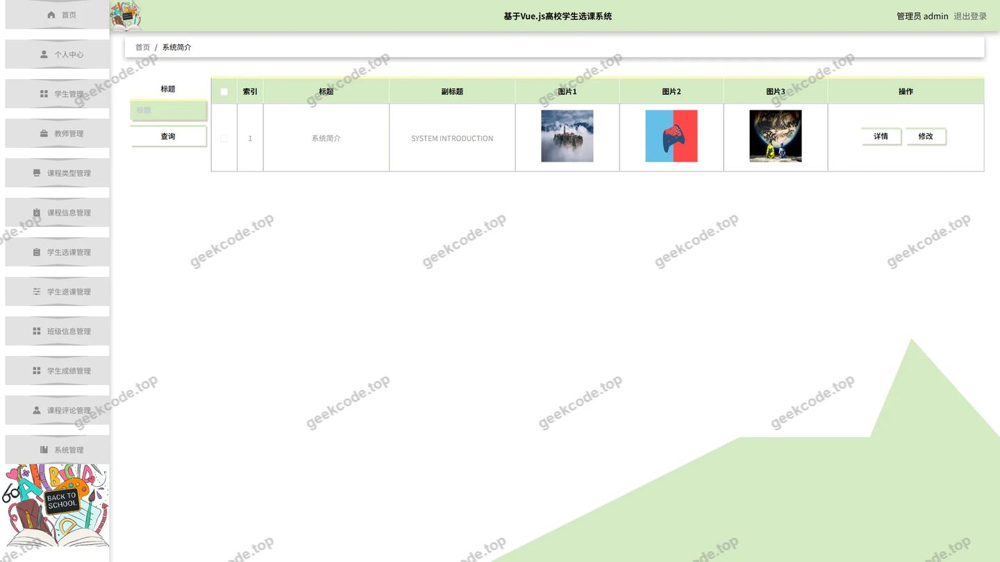</a>

<h4>后台-课程评论</h4>

<a href="https://geekcode.top/archives/%E5%9F%BA%E4%BA%8EVue.js%E9%AB%98%E6%A0%A1%E5%AD%A6%E7%94%9F%E9%80%89%E8%AF%BE%E7%B3%BB%E7%BB%9F?utm_source=github" title="查看完整源码">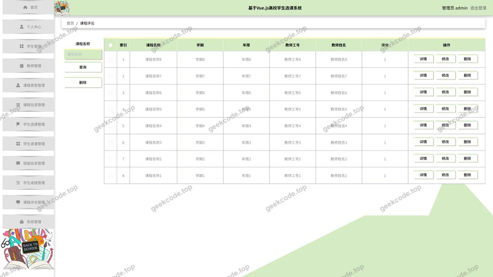</a>

<h4>后台首页</h4>

<a href="https://geekcode.top/archives/%E5%9F%BA%E4%BA%8EVue.js%E9%AB%98%E6%A0%A1%E5%AD%A6%E7%94%9F%E9%80%89%E8%AF%BE%E7%B3%BB%E7%BB%9F?utm_source=github" title="查看完整源码">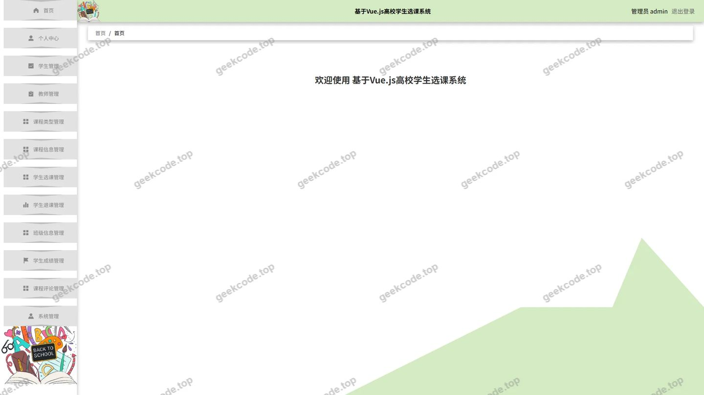</a>

<h4>后台-学生</h4>

<a href="https://geekcode.top/archives/%E5%9F%BA%E4%BA%8EVue.js%E9%AB%98%E6%A0%A1%E5%AD%A6%E7%94%9F%E9%80%89%E8%AF%BE%E7%B3%BB%E7%BB%9F?utm_source=github" title="查看完整源码">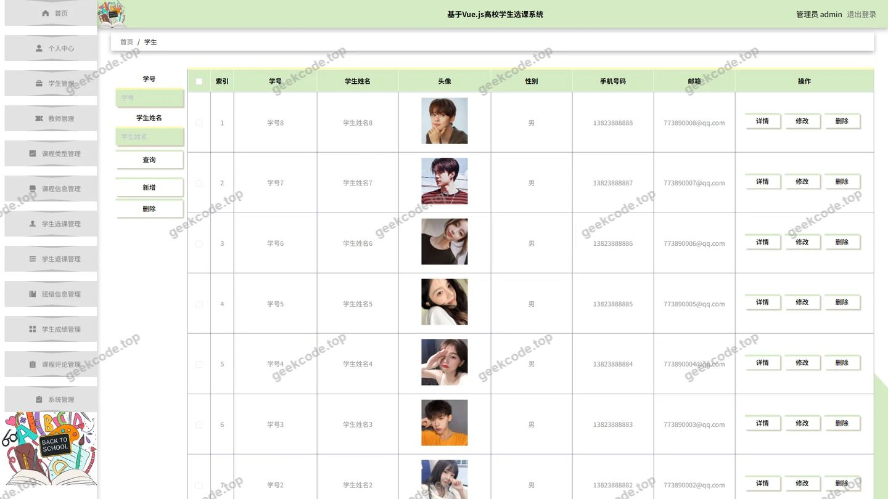</a>

<h4>后台-学生退课</h4>

<h4>后台-学生选课</h4>

<a href="https://geekcode.top/archives/%E5%9F%BA%E4%BA%8EVue.js%E9%AB%98%E6%A0%A1%E5%AD%A6%E7%94%9F%E9%80%89%E8%AF%BE%E7%B3%BB%E7%BB%9F?utm_source=github" title="查看完整源码">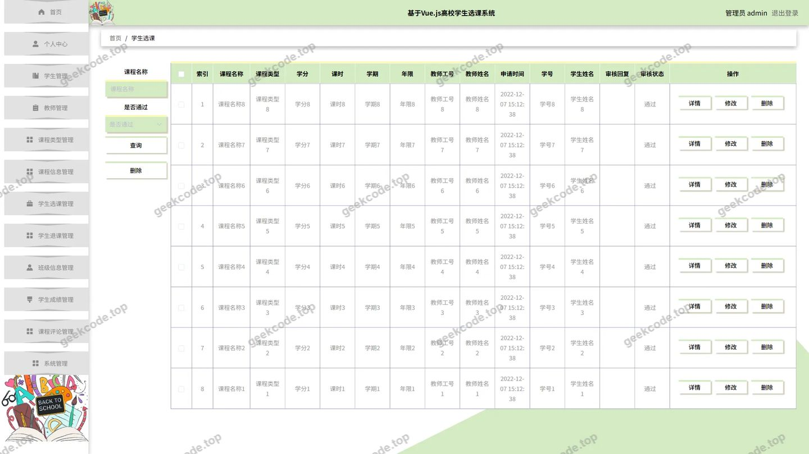</a>

---

## 获取完整源码

| 项目 | 说明 |
| --- | --- |
| 项目名 | 基于Vue.js高校学生选课系统 |
| 运行截图 | 本文 18 张（站点带水印原图，仓库 `images/` 目录） |
| 完整源码 | [https://geekcode.top/archives/%E5%9F%BA%E4%BA%8EVue.js%E9%AB%98%E6%A0%A1%E5%AD%A6%E7%94%9F%E9%80%89%E8%AF%BE%E7%B3%BB%E7%BB%9F?utm_source=github](https://geekcode.top/archives/%E5%9F%BA%E4%BA%8EVue.js%E9%AB%98%E6%A0%A1%E5%AD%A6%E7%94%9F%E9%80%89%E8%AF%BE%E7%B3%BB%E7%BB%9F?utm_source=github) |
| 咨询微信 | **ir9372**（备注：jingpin-yuanma） |
| 更多项目 | [极客代码 geekcode.top](https://geekcode.top/?utm_source=github) |

> 需要源码、部署、改配置、跑不起来等问题，加微信 ir9372 沟通，说明项目名即可。
